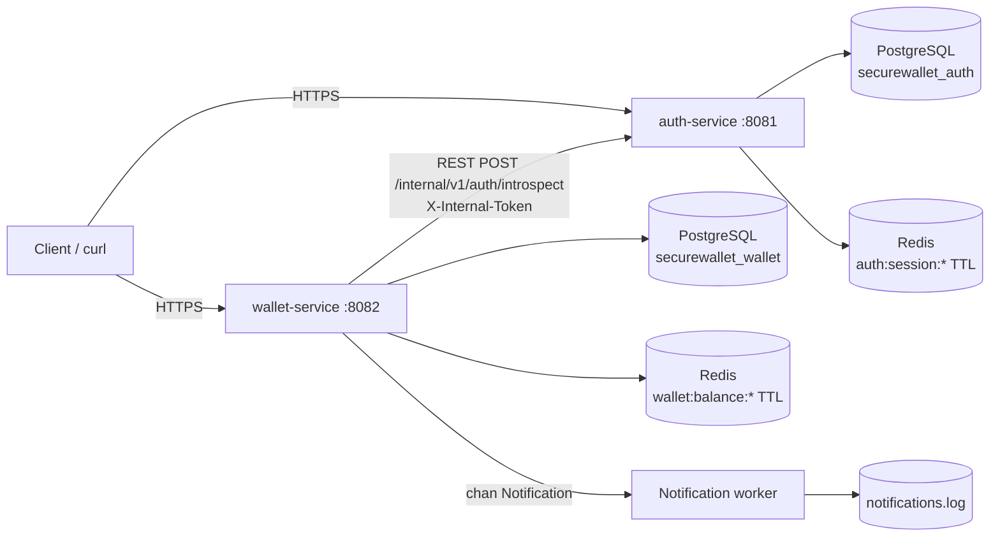

# SecureWallet

Микросервисный бэкенд цифрового кошелька: регистрация и JWT-сессии, P2P-переводы с ACID-гарантиями и идемпотентностью, кэширование баланса в Redis, привязка карт с AES-256-GCM и маскированием PAN/CVV в логах.

Проект сделан как учебно-портфолио срез: здесь есть не только happy path, но и транзакционные блокировки, повторные запросы, откаты, TTL сессий, ограниченная очередь уведомлений и осознанная работа с чувствительными данными.

---

## Содержание

- [Архитектура](#архитектура)
- [Возможности](#возможности)
- [Стек](#стек)
- [Структура проекта](#структура-проекта)
- [Быстрый старт](#быстрый-старт)
- [Сценарий работы через curl](#сценарий-работы-через-curl)
- [HTTP API](#http-api)
- [Как устроены переводы](#как-устроены-переводы)
- [Идемпотентность](#идемпотентность)
- [Redis: сессии и кэш](#redis-сессии-и-кэш)
- [Асинхронные уведомления](#асинхронные-уведомления)
- [Security & PCI DSS](#security--pci-dss)
- [Тесты](#тесты)
- [Миграции Goose](#миграции-goose)
- [Конфигурация](#конфигурация)
- [Make-команды](#make-команды)
- [Ограничения и что улучшить в production](#ограничения-и-что-улучшить-в-production)

---

## Архитектура



Два независимых сервиса и две логические БД. `wallet-service` не ходит в БД авторизации и не хранит пароли: он получает подтверждённую личность через внутренний REST-эндпоинт `auth-service`. Идентификатор пользователя в `wallet-service` — внешний ключ без физического FK между базами. Это сохраняет границы bounded context.

Redis используется двумя сервисами совместно, но с разными пространствами ключей:

| Ключ | Владелец | TTL | Назначение |
|---|---|---|---|
| `auth:session:<jti>` | auth-service | `JWT_TTL` (1h по умолчанию) | server-side сессия; logout удаляет ключ |
| `wallet:balance:<wallet_id>` | wallet-service | 5m по умолчанию | кэш баланса и валюты |

---

## Возможности

**Auth**
- `POST /api/v1/auth/register`, `POST /api/v1/auth/login`, `POST /api/v1/auth/logout`, `GET /api/v1/auth/me`.
- Пароли — bcrypt cost 12; e-mail нормализуется и проверяется.
- JWT HS256 с `iss`, `aud`, `sub`, `jti`, `iat`, `nbf`, `exp`.
- Каждая JWT-сессия дополнительно хранится в Redis с TTL. Wallet-service проверяет её через REST-introspection, поэтому logout действует немедленно.

**Wallet**
- `POST /api/v1/wallets` — создать/получить кошелёк пользователя.
- `POST /api/v1/wallets/top-up` — пополнение (эмуляция внешнего платежа).
- `POST /api/v1/wallets/transfer` — P2P-перевод между кошельками.
- `GET /api/v1/wallets/{id}/balance` — баланс с cache-aside.
- `GET /api/v1/wallets/{id}/transactions` — история операций.
- `POST /api/v1/cards`, `GET /api/v1/cards` — привязка карт и безопасное отображение.
- Атомарный перевод: `SELECT ... FOR UPDATE` в детерминированном порядке, проверка баланса, два `UPDATE`, запись в ledger, `COMMIT`.
- Идемпотентность по `(initiated_by, idempotency_key)` + сверка хэша запроса.
- Асинхронный воркер уведомлений на goroutine + канал.
- Кастомный JSON-логгер, рекурсивно маскирующий PAN/CVV.

---

## Стек

- **Go 1.25+** (модуль собран локально на Go 1.27, Docker — `golang:1.27-alpine`)
- **chi** — HTTP-роутер и middleware
- **PostgreSQL 16** + **pgx/v5/pgxpool**
- **Redis 7** + **go-redis/v9**
- **Goose** — встраиваемые миграции
- **zerolog** — структурированные JSON-логи
- **golang-jwt/jwt/v5**, **bcrypt**, **AES-256-GCM**, **HMAC-SHA256**
- **testify** + **mockery** — unit-тесты сервисного слоя
- **Docker / Docker Compose**

---

## Структура проекта

```text
.
├── cmd/
│   ├── auth/                 # auth-service entrypoint
│   ├── wallet/               # wallet-service entrypoint
│   └── migrate/              # одноразовый Goose-мигратор для обеих БД
├── internal/
│   ├── auth/
│   │   ├── config/
│   │   ├── domain/
│   │   ├── repository/       # users (pgx)
│   │   ├── service/          # register/login/session logic
│   │   ├── session/          # Redis sessions
│   │   └── transport/http/   # chi handlers + auth middleware
│   ├── wallet/
│   │   ├── authclient/       # REST-клиент к auth-service
│   │   ├── cache/            # Redis balance cache
│   │   ├── config/
│   │   ├── domain/
│   │   ├── mocks/            # testify/mockery mocks
│   │   ├── notifier/         # goroutine + channel worker
│   │   ├── repository/       # ACID transfer/top-up, cards
│   │   ├── service/          # бизнес-логика
│   │   └── transport/http/
│   ├── platform/
│   │   ├── config/
│   │   ├── database/         # pgxpool + Redis clients
│   │   ├── httpx/            # JSON, request id, logging, recover
│   │   ├── migrator/         # Goose runner
│   │   ├── safelog/          # PAN/CVV masking logger
│   │   └── security/         # JWT, AES-GCM, PAN validation
├── migrations/
│   ├── auth/00001_init.sql
│   ├── wallet/00001_init.sql
│   └── embed.go
├── deploy/postgres/init.sql  # создаёт вторую логическую БД
├── Dockerfile
├── docker-compose.yml
├── Makefile
└── .env.example
```

---

## Быстрый старт

### Требования

- Docker Desktop / Docker Engine + Compose v2.
- `make` — опционально; на Windows без `make` используйте команды `docker compose ...`.

### Запуск

```bash
cp .env.example .env
make up
# или:
# docker compose up --build -d
```

Проверка:

```bash
docker compose ps
curl http://localhost:8081/healthz
curl http://localhost:8082/healthz
curl http://localhost:8081/readyz
curl http://localhost:8082/readyz
```

Ожидаемые ответы — `{"status":"ok"}` и `{"status":"ready"}`.

Стек поднимает:

1. `postgres` — две БД: `securewallet_auth` и `securewallet_wallet`;
2. `redis` — сессии и кэш;
3. `migrate` — одноразовый контейнер с Goose; применяет обе миграции и завершается успешно;
4. `auth-service` — `http://localhost:8081`;
5. `wallet-service` — `http://localhost:8082`.

Логи:

```bash
make logs
# или
docker compose logs -f auth-service wallet-service
```

Остановка:

```bash
make down      # данные сохраняются
make down-v    # вместе с volumes (БД, Redis, notifications.log)
```

> `.env.example` содержит только локальные dev-секреты. Замените их перед любым публичным развёртыванием.
> На Windows: `Copy-Item .env.example .env`.

### Проверка уведомлений

После успешного перевода:

```bash
docker compose exec wallet-service cat /var/lib/securewallet/notifications.log
```

В файл пишутся JSON-события без PAN, CVV и других данных карты.

---

## Сценарий работы через curl

Понадобятся `curl` и, желательно, `jq`. Все суммы — **в minor units** (копейках/центах): `10050` = `100.50`.

### 1. Регистрация двух пользователей

```bash
curl -sS -X POST http://localhost:8081/api/v1/auth/register \
  -H 'Content-Type: application/json' \
  -d '{
    "email": "alice@example.com",
    "password": "S3curePass!",
    "full_name": "Alice"
  }'
```

```json
{
  "token": "eyJ...",
  "token_type": "Bearer",
  "expires_in": 3599,
  "expires_at": "2026-10-27T00:00:00Z",
  "user": {
    "id": "…",
    "email": "alice@example.com",
    "full_name": "Alice"
  }
}
```

Повторите для `bob@example.com` и сохраните токены:

```bash
TOKEN_A=$(curl -sS -X POST http://localhost:8081/api/v1/auth/register \
  -H 'Content-Type: application/json' \
  -d '{"email":"alice@example.com","password":"S3curePass!","full_name":"Alice"}' | jq -r .token)

TOKEN_B=$(curl -sS -X POST http://localhost:8081/api/v1/auth/register \
  -H 'Content-Type: application/json' \
  -d '{"email":"bob@example.com","password":"S3curePass!","full_name":"Bob"}' | jq -r .token)
```

Если пользователи уже созданы, используйте `login`:

```bash
TOKEN_A=$(curl -sS -X POST http://localhost:8081/api/v1/auth/login \
  -H 'Content-Type: application/json' \
  -d '{"email":"alice@example.com","password":"S3curePass!"}' | jq -r .token)
```

### 2. Создание кошельков

```bash
WALLET_A=$(curl -sS -X POST http://localhost:8082/api/v1/wallets \
  -H "Authorization: Bearer $TOKEN_A" \
  -H 'Content-Type: application/json' \
  -d '{"currency":"USD"}' | jq -r .id)

WALLET_B=$(curl -sS -X POST http://localhost:8082/api/v1/wallets \
  -H "Authorization: Bearer $TOKEN_B" \
  -H 'Content-Type: application/json' \
  -d '{"currency":"USD"}' | jq -r .id)
```

### 3. Пополнение

```bash
curl -sS -i -X POST http://localhost:8082/api/v1/wallets/top-up \
  -H "Authorization: Bearer $TOKEN_A" \
  -H 'Content-Type: application/json' \
  -H 'Idempotency-Key: topup-alice-0001' \
  -d "{
    \"wallet_id\": \"$WALLET_A\",
    \"amount_minor\": 10000
  }"
```

Ожидается `201 Created`. `idempotency_key` можно передать и в теле; заголовок `Idempotency-Key` имеет более низкий приоритет, если поле задано в JSON.

### 4. Перевод

```bash
curl -sS -i -X POST http://localhost:8082/api/v1/wallets/transfer \
  -H "Authorization: Bearer $TOKEN_A" \
  -H 'Content-Type: application/json' \
  -d "{
    \"sender_wallet_id\": \"$WALLET_A\",
    \"receiver_wallet_id\": \"$WALLET_B\",
    \"amount_minor\": 2500,
    \"idempotency_key\": \"transfer-alice-bob-0001\"
  }"
```

Ожидается `201 Created` и транзакция в статусе `completed`.

### 5. Балансы

```bash
# Первый запрос — из PostgreSQL, cached=false
curl -sS http://localhost:8082/api/v1/wallets/$WALLET_A/balance \
  -H "Authorization: Bearer $TOKEN_A"

# Повторный — из Redis, cached=true
curl -sS http://localhost:8082/api/v1/wallets/$WALLET_A/balance \
  -H "Authorization: Bearer $TOKEN_A"
```

После перевода: у Alice `7500`, у Bob `2500`.

### 6. Идемпотентный повтор

Повторите **точно тот же** `POST /transfer` с тем же `transfer-alice-bob-0001`. Сервер вернёт `200 OK`, тот же `transaction.id` и `"idempotent_replay": true`, но **не** спишет деньги второй раз и не отправит повторное уведомление.

Если использовать тот же ключ с другой суммой или другим получателем:

```json
HTTP/1.1 409 Conflict
{"error":{"code":"idempotency_conflict","message":"idempotency key was already used with a different payload"}}
```

### 7. Недостаточно средств

```bash
curl -sS -i -X POST http://localhost:8082/api/v1/wallets/transfer \
  -H "Authorization: Bearer $TOKEN_A" \
  -H 'Content-Type: application/json' \
  -d "{
    \"sender_wallet_id\": \"$WALLET_A\",
    \"receiver_wallet_id\": \"$WALLET_B\",
    \"amount_minor\": 999999,
    \"idempotency_key\": \"transfer-insufficient-0001\"
  }"
```

Ожидается `402 Payment Required` с `insufficient_funds`. Транзакция откатывается, баланс не меняется.

### 8. История операций

```bash
curl -sS "http://localhost:8082/api/v1/wallets/$WALLET_A/transactions?limit=20" \
  -H "Authorization: Bearer $TOKEN_A"
```

### 9. Привязка карты

```bash
curl -sS -i -X POST http://localhost:8082/api/v1/cards \
  -H "Authorization: Bearer $TOKEN_A" \
  -H 'Content-Type: application/json' \
  -d '{
    "card_number": "4242 4242 4242 4242",
    "cardholder_name": "ALICE EXAMPLE",
    "exp_month": 12,
    "exp_year": 2035
  }'
```

Ответ содержит только безопасные метаданные:

```json
{
  "id": "…",
  "token": "card_…",
  "masked_number": "**** **** **** 4242",
  "last_four_digits": "4242",
  "cardholder_name": "ALICE EXAMPLE",
  "brand": "visa",
  "exp_month": 12,
  "exp_year": 2035,
  "created_at": "…"
}
```

`cvv` в DTO отсутствует, а JSON-декодер работает с `DisallowUnknownFields()`. Поэтому запрос с `cvv` отклоняется с `400`, а не «молча сохраняет» его.

### 10. Logout

```bash
curl -sS -i -X POST http://localhost:8081/api/v1/auth/logout \
  -H "Authorization: Bearer $TOKEN_A"
# 204 No Content

# Следующий защищённый запрос вернёт 401, даже если JWT ещё не истёк:
curl -sS -i http://localhost:8082/api/v1/wallets \
  -H "Authorization: Bearer $TOKEN_A"
```

---

## HTTP API

### auth-service

| Метод | Путь | Auth | Успех | Назначение |
|---|---|---|---|---|
| `GET` | `/healthz` | — | 200 | liveness |
| `GET` | `/readyz` | — | 200 / 503 | Postgres + Redis |
| `POST` | `/api/v1/auth/register` | — | 201 | регистрация + сессия |
| `POST` | `/api/v1/auth/login` | — | 200 | вход + сессия |
| `GET` | `/api/v1/auth/me` | Bearer | 200 | текущий пользователь |
| `POST` | `/api/v1/auth/logout` | Bearer | 204 | удаление Redis-сессии |
| `POST` | `/internal/v1/auth/introspect` | `X-Internal-Token` | 200 | проверка сессии для wallet-service |

### wallet-service

| Метод | Путь | Auth | Успех | Назначение |
|---|---|---|---|---|
| `GET` | `/healthz` | — | 200 | liveness |
| `GET` | `/readyz` | — | 200 / 503 | Postgres + Redis |
| `GET` | `/api/v1/wallets` | Bearer | 200 | кошельки пользователя |
| `POST` | `/api/v1/wallets` | Bearer | 201 | создать/получить кошелёк |
| `POST` | `/api/v1/wallets/top-up` | Bearer | 201 / 200 replay | пополнение |
| `POST` | `/api/v1/wallets/transfer` | Bearer | 201 / 200 replay | P2P-перевод |
| `GET` | `/api/v1/wallets/{id}/balance` | Bearer | 200 | баланс |
| `GET` | `/api/v1/wallets/{id}/transactions` | Bearer | 200 | история |
| `POST` | `/api/v1/cards` | Bearer | 201 | привязать карту |
| `GET` | `/api/v1/cards` | Bearer | 200 | список карт (masked) |

### Коды ошибок

| Код | Когда |
|---|---|
| `400` | невалидный JSON, UUID, сумма, валюта, idempotency key |
| `401` | нет/просрочен JWT, сессия удалена, неверный пароль |
| `402` | недостаточно средств |
| `403` | кошелёк принадлежит другому пользователю |
| `404` | кошелёк/маршрут не найден |
| `405` | метод не поддерживается |
| `409` | e-mail занят, повтор idempotency key с другим payload, карта уже привязана |
| `500` | внутренняя ошибка; детали не раскрываются клиенту |
| `503` | auth-service или зависимости недоступны |

Единый формат ошибки:

```json
{
  "error": {
    "code": "insufficient_funds",
    "message": "insufficient funds for this transfer"
  }
}
```

---

## Как устроены переводы

`wallet-service/internal/wallet/repository.Transfer` выполняет один PostgreSQL-транзакционный сценарий:

1. `BEGIN`.
2. `pg_advisory_xact_lock(hashtextextended(actor_id || ':' || idempotency_key, 0))` — сериализует одновременные повторы одного ключа.
3. Поиск уже завершённой транзакции по `(initiated_by, idempotency_key)`.
   - если она есть и `request_hash` совпадает → возвращаем её, `replayed=true`;
   - если payload другой → `409 idempotency_conflict`.
4. Оба кошелька читаются одним запросом:
   ```sql
   SELECT ...
   FROM wallets
   WHERE id IN ($1, $2)
   ORDER BY id
   FOR UPDATE;
   ```
   Единый порядок блокировок исключает взаимную блокировку двух встречных переводов.
5. Проверяются владелец отправителя, совпадение валют и достаточность баланса.
6. `UPDATE` списания и `UPDATE` зачисления.
7. `INSERT INTO transactions` со статусом `completed`.
8. `COMMIT`; на любой ошибке — откат через `defer tx.Rollback(...)`.

Деньги представлены целыми minor units (`BIGINT`): никакой `float`/`double` в финансовой арифметике. `balance_minor >= 0` дополнительно закреплено CHECK-ограничением.

`top-up` использует ту же схему для одного кошелька и создаёт ledger-запись с `sender_wallet_id = NULL`.

### Схема БД

- `wallets(id, user_id, currency, balance_minor, ...)`, `UNIQUE(user_id, currency)`.
- `transactions(id, initiated_by, type, sender_wallet_id, receiver_wallet_id, amount_minor, status, idempotency_key, request_hash, ...)`, `UNIQUE(initiated_by, idempotency_key)`.
- `cards(id, user_id, encrypted_card_number, pan_fingerprint, token, last_four_digits, cardholder_name, brand, exp_month, exp_year, ...)`.
- **колонки CVV нет вообще**.

---

## Идемпотентность

Ключ идемпотентности проверяется **внутри** транзакции, после advisory lock. Это защищает от гонки, когда два одинаковых HTTP-запроса приходят одновременно.

- ключ: 8–128 символов, обязателен;
- уникальность: в рамках `initiated_by` (пользователя), а не глобально;
- `request_hash = SHA-256` канонического представления операции (тип, кошельки, сумма, длина полей);
- повтор с тем же payload → `200 OK`, `idempotent_replay=true`, без второго списания и уведомления;
- повтор с другим payload → `409`.

Клиенту следует генерировать UUID/ULID на каждую бизнес-операцию и повторять запрос с тем же ключом при сетевом таймауте.

---

## Redis: сессии и кэш

### Сессии

- JWT содержит `jti`.
- `auth-service` кладёт `auth:session:<jti>` в Redis с TTL, равным времени жизни токена.
- `wallet-service` не доверяет JWT «сам по себе»: middleware вызывает `POST /internal/v1/auth/introspect`, а auth-service проверяет и подпись, и наличие сессии в Redis.
- `logout` удаляет ключ → токен перестаёт работать немедленно, не дожидаясь `exp`.

### Кэш баланса

- `GET /balance`: Redis → при промахе PostgreSQL → запись в Redis с TTL 5 минут.
- В кэше дополнительно хранится `user_id`, чтобы проверять владельца без похода в БД.
- После успешного `transfer` инвалидируются оба кошелька; после `top-up` — один.
- Ошибка Redis не ломает чтение: сервис логирует warning и отвечает из PostgreSQL.
- В ответе есть флаг `cached`, по которому видно, был ли hit.

Кэш — оптимизация, а не источник истины. TTL ограничивает окно возможной рассинхронизации.

---

## Асинхронные уведомления

После `COMMIT` сервис кладёт `domain.Notification` в буферизованный канал:

```go
select {
case worker.events <- notification:
default:
    // буфер полон — событие отбрасывается с warning
}
```

Отдельная goroutine читает канал и дописывает JSON-строки в `notifications.log` (в Docker — volume `notifications-data`). Запрос HTTP не блокируется на «отправке письма».

В событии есть только `recipient_user_id`, `transaction_id`, тип, сумма и валюта. Никаких PAN/CVV. В production этот слой заменяется на transactional outbox + очередь (Kafka/RabbitMQ) и провайдера email/push; интерфейс `NotificationPublisher` останется тем же.

---

## Security & PCI DSS

> Это учебный проект и **не** заявление о сертификации PCI DSS. Ниже — реализованные меры и границы применимости.

### Что хранится и как

| Данные | Хранение | Мера |
|---|---|---|
| Номер карты (PAN) | `cards.encrypted_card_number` | AES-256-GCM, случайный 12-байтный nonce на каждое шифрование |
| Дубликаты карт | `cards.pan_fingerprint` | HMAC-SHA256 с отдельным ключом; необратимый fingerprint |
| Последние 4 цифры | `cards.last_four_digits` | разрешённое отображение для UI |
| CVV/CVC | **не хранится и не принимается** | поля нет в DTO; strict JSON отклоняет неизвестные поля |
| Пароль | `users.password_hash` | bcrypt cost 12 |
| JWT | у клиента | короткий TTL; серверная сессия в Redis |
| Сессия | Redis | TTL; logout удаляет |
| Логи | stdout / файл | кастомный `safelog` маскирует поля и свободный текст |

### Маскирование в логах

`internal/platform/safelog` — обёртка над zerolog, через которую проходят все структурированные поля:

- рекурсивно обходит `map`, `struct`, `slice`, указатели;
- по ключам `card_number`, `pan`, `cvv`, `cvc`, `security_code`, `cardNumber`, `encrypted_card_number` и др. заменяет значения;
- PAN в свободном тексте (`charge 4242 4242 4242 4242 failed`) распознаётся регулярным выражением и превращается в `**** **** **** 4242`;
- CVV превращается в `***`;
- байтовые массивы никогда не логируются как содержимое;
- тела запросов и заголовок `Authorization` не логируются вообще.

Пример:

```json
{"level":"info","card_number":"**** **** **** 4242","cvv":"***","wallet_id":"…"}
```

Тесты `safelog` проверяют, что исходный PAN и CVV физически отсутствуют в выводе логгера.

### Транспорт

- В production API должно работать **только по HTTPS/TLS 1.2+** (в идеале TLS 1.3), с HSTS на ingress.
- Внутренние вызовы `wallet-service → auth-service` в production следует перевести на mTLS/service mesh; в локальном compose используется HTTP и общий `X-Internal-Token`.
- Пароли и TLS-ключи не должны попадать в образы и репозиторий; используйте KMS/Vault/секреты оркестратора.

### Ключи и криптография

- `CARD_ENCRYPTION_KEY` и `CARD_FINGERPRINT_KEY` — разные 32-байтные ключи в base64.
- В production ключи хранятся в KMS/HSM, ротация — через версионирование ciphertext (в pet-проекте не реализована).
- PAN никогда не пишется в SQL-логи, ответы API, кэш Redis или файл уведомлений.
- AES-GCM даёт конфиденциальность и аутентификацию ciphertext; nonce не повторяется.
- HMAC не позволяет восстановить номер, но позволяет найти уже привязанную карту.

### Приложение

- `DisallowUnknownFields` не даёт случайно принять `cvv`.
- SQL только с параметрами (`$1`, `$2`) — без конкатенации пользовательских данных.
- Ошибки наружу не раскрывают внутренние детали; логи correlation-id.
- Контейнеры работают от non-root, rootfs `read_only`, `no-new-privileges`.
- JWT подписывается HS256 секретом ≥ 32 символов; проверяются `alg`, `iss`, `aud`, `exp`, `nbf`.
- Пароли не логируются и не возвращаются.
- Для production добавить: rate limiting, account lockout, email verification, 2FA, WAF, аудит-лог доступа к картам, шифрование резервных копий.

---

## Тесты

```bash
make test
# или
go test ./...
```

Покрытые сценарии сервисного слоя (`testify` + mockery-моки репозитория):

- успешный перевод: оба кэша инвалидируются, уведомление публикуется;
- недостаточно средств: ошибка `ErrInsufficientFunds`, без уведомления;
- ошибка БД: ошибка прокидывается, побочные эффекты не выполняются;
- идемпотентный replay: без повторной инвалидации/уведомления;
- чужой кошелёк: `403`, репозиторий не вызывается;
- невалидные входные данные: отказ до обращения к репозиторию;
- cache hit без запроса в БД и graceful fallback при недоступном Redis;
- top-up + replay;
- шифрование карты и отсутствие PAN в результате.

Дополнительно:

- `safelog`: маскирование вложенных полей, структур, свободного текста; проверка, что PAN/CVV не попадают в JSON-лог.
- `security`: JWT issue/parse, неверный секрет, AES-GCM roundtrip, уникальные nonce, Luhn, last4.
- `auth service`: register/login/logout, удаление сессии, duplicate e-mail, слабый пароль, неверный пароль.
- `notifier`: запись событий в отдельный файл и безопасное завершение.

### Интеграционный тест PostgreSQL

Отдельный тест с build-тегом `integration` проверяет настоящие блокировки и откаты:

```bash
TEST_WALLET_DATABASE_URL='postgres://postgres@localhost:5432/securewallet_wallet?sslmode=disable' \
  make test-integration
```

Он применяет Goose-миграции и проверяет: успешный перевод, идемпотентный replay (transfer и top-up), конфликт payload, `402`-сценарий с откатом, чужой кошелёк, несовпадение валют и **конкурентные переводы** (два одновременных списания с баланса, которого хватает только на одно). В CI этот job запускается с сервисным контейнером PostgreSQL.

Регенерация моков:

```bash
make mocks
```

> `go test -race` требует CGO и установленный C-компилятор; в CI/Docker-образе с gcc команда `make test-race` работает.

---

## Миграции Goose

SQL-файлы лежат в `migrations/auth` и `migrations/wallet`, встроены в бинарник через `embed`. Одноразовый сервис `migrate` применяет обе БД:

```bash
make migrate
# или
docker compose run --rm migrate
```

Почему отдельный контейнер: приложение не должно гонять миграции при каждом рестарте и не должно иметь права менять схему в runtime. Для локальной отладки можно включить `AUTO_MIGRATE=true`.

Создать новую миграцию:

```bash
go run github.com/pressly/goose/v3/cmd/goose@v3.24.1 \
  -dir migrations/wallet create add_something sql
```

---

## Конфигурация

Все настройки читаются из environment variables. Значения ниже — dev-defaults из compose.

### auth-service

| Переменная | Обязательна | Default | Описание |
|---|---:|---|---|
| `HTTP_ADDR` | нет | `:8081` | адрес HTTP |
| `DATABASE_URL` | да | — | PostgreSQL auth DB |
| `REDIS_URL` | нет | `redis://localhost:6379/0` | Redis |
| `JWT_SECRET` | да | — | ≥ 32 символов |
| `JWT_ISSUER` | нет | `securewallet-auth` | `iss` |
| `JWT_TTL` | нет | `1h` | TTL JWT и Redis-сессии |
| `INTERNAL_API_TOKEN` | да | — | ≥ 24 символов, для introspect |
| `DB_MAX_CONNECTIONS` | нет | `10` | pgx pool |
| `AUTO_MIGRATE` | нет | `false` | применить auth-миграции на старте |
| `LOG_LEVEL` | нет | `info` | zerolog level |
| `SHUTDOWN_TIMEOUT` | нет | `10s` | graceful shutdown |

### wallet-service

| Переменная | Обязательна | Default | Описание |
|---|---:|---|---|
| `HTTP_ADDR` | нет | `:8082` | адрес HTTP |
| `DATABASE_URL` | да | — | PostgreSQL wallet DB |
| `REDIS_URL` | нет | `redis://localhost:6379/0` | Redis |
| `AUTH_SERVICE_URL` | нет | `http://localhost:8081` | internal auth-service |
| `AUTH_SERVICE_TIMEOUT` | нет | `3s` | timeout introspection |
| `INTERNAL_API_TOKEN` | да | — | тот же, что у auth-service |
| `CARD_ENCRYPTION_KEY` | да | — | base64 32 байта |
| `CARD_FINGERPRINT_KEY` | да | — | base64 32 байта, другой ключ |
| `BALANCE_CACHE_TTL` | нет | `5m` | TTL кэша баланса |
| `NOTIFICATIONS_FILE` | нет | `notifications.log` | файл воркера |
| `NOTIFICATION_BUFFER` | нет | `1024` | размер канала |
| `DB_MAX_CONNECTIONS` | нет | `10` | pgx pool |
| `AUTO_MIGRATE` | нет | `false` | применить wallet-миграции |
| `LOG_LEVEL` | нет | `info` | zerolog level |
| `SHUTDOWN_TIMEOUT` | нет | `10s` | graceful shutdown |

Сгенерировать ключи:

```bash
openssl rand -base64 32   # CARD_ENCRYPTION_KEY
openssl rand -base64 32   # CARD_FINGERPRINT_KEY
openssl rand -hex 32      # JWT_SECRET (64 hex-символа)
openssl rand -hex 24      # INTERNAL_API_TOKEN
```

---

## Make-команды

| Команда | Действие |
|---|---|
| `make up` | собрать, применить миграции, запустить |
| `make down` | остановить, сохранить данные |
| `make down-v` | остановить и удалить volumes |
| `make logs` | follow logs auth/wallet |
| `make ps` | статус контейнеров |
| `make test` | unit-тесты |
| `make test-race` | тесты с race detector |
| `make test-integration` | ACID-тест на реальном PostgreSQL |
| `make fmt` / `make vet` | форматирование / статический анализ |
| `make mocks` | перегенерировать mockery-моки |
| `make migrate` | прогнать Goose-миграции |
| `make build` | собрать Go-бинарники |
| `make docker-build` | собрать runtime-образ |

---

## Ограничения и что улучшить в production

Осознанные границы учебного проекта:

- `top-up` эмулирует успешный внешний платёж; нет интеграции с PCI-совместимым провайдером и 3-D Secure.
- Нет транзакционного outbox: при падении процесса между `COMMIT` и записью в канал уведомление может потеряться. Для production — outbox + очередь.
- Кэш баланса — cache-aside с TTL; при гонке чтения и инвалидации возможно кратковременное устаревание. Для строгой консистентности нужен версионный кэш или отказ от кэша баланса.
- Нет rate limiting, CAPTCHA, 2FA, подтверждения e-mail и блокировки аккаунта после серии неудачных входов.
- Нет полноценного двойного ledger (debit/credit entries); для реального финтеха нужна бухгалтерская модель с проводками и сверкой.
- Интеграционный тест покрывает PostgreSQL/ACID, но сквозной сценарий с настоящим Redis в CI пока не запускается.
- Ключи карт хранятся в environment; production — KMS/HSM + ротация.
- Локальный compose публикует PostgreSQL/Redis на host и не включает Redis AUTH/TLS — это удобно для отладки, но недопустимо в production.
- HTTP-клиент между сервисами не использует mTLS.
- Нет OpenTelemetry/tracing и централизованного audit-log.

Следующие шаги, которые усилят проект для резюме: outbox pattern, OpenTelemetry, integration-тесты через testcontainers, k6 нагрузочный тест, GitHub Actions с Docker-сборкой и Trivy, OpenAPI-спека.
